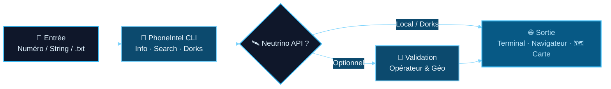

<div align="center">

<!-- BANNIÈRE ANIMÉE BLEU CLAIR -->


<!-- EFFET TERMINAL ANIMÉ -->
<a href="#sommaire">
  
</a>

<br />

<!-- BADGES SHIELDS.IO BLEU CLAIR -->
<p>
  <a href="https://pypi.org/project/phoneintel/">
    
  </a>
  <a href="https://www.python.org/">
    
  </a>
  
  
  
</p>

</div>

---

<a id="sommaire"></a>

## 🧭 𝗦𝗢𝗠𝗠𝗔𝗜𝗥𝗘 𝗢𝗣𝗘́𝗥𝗔𝗧𝗜𝗢𝗡𝗡𝗘𝗟

| # | Section | Aperçu Rapide | Accès |
| :-: | :--- | :--- | :---: |
| `01` | **🫆 Présentation & `v1.1-alpha`** | Objectif OSINT, nouveautés alpha & aperçu console | [**Voir ➔**](#apercu-v11) |
| `02` | **⚡ Fonctionnalités Clés** | Recherche, Dorks, Traitement par lots, Neutrino & Cartes | [**Voir ➔**](#fonctionnalites) |
| `03` | **🔄 Architecture Simple** | Pipeline visuel Mermaid du traitement d'un numéro | [**Voir ➔**](#architecture) |
| `04` | **📥 Installation** | Prérequis Python 3.8+, `pip` & guide `install.md` | [**Voir ➔**](#installation) |
| `05` | **🖥️ Utilisation & Commandes** | Toutes les commandes CLI classées par cas d'usage | [**Voir ➔**](#utilisation) |
| `06` | **⚖️ Avertissement & Licence** | Cadre légal d'utilisation et licence `BSD-3` | [**Voir ➔**](#avertissement) |

---

<a id="apercu-v11"></a>

## 🫆 𝗣𝗥𝗘́𝗦𝗘𝗡𝗧𝗔𝗧𝗜𝗢𝗡 (`v1.1-alpha`)

> [!IMPORTANT]
> **PhoneIntel `v1.1-alpha`** — Outil **OSINT** (*Open Source Intelligence*) léger en ligne de commande, conçu pour collecter et corréler des **informations publiques sur les numéros de téléphone** *(opérateur, localisation, dorks ciblés, batch & API Neutrino)*.

### ✨ Aperçu visuel console

```text
  ╭──────────────────────────────────────────────────────────────────╮
  │  🫆  PHONEINTEL v1.1-alpha  •  OSINT CLI  •  🤖 ANDROID / LINUX  │
  ╰──────────────────────────────────────────────────────────────────╯
   [+] Cible       : +14155552671
   [+] Opérateur   : Carrier Lookup & Metadata OK
   [+] Zone        : San Francisco, CA (US)
   [+] Carte       : https://maps.google.com/?q=...
   [+] Dorks       : social_networks | forums | pastes | ecommerce
```

> [!NOTE]
> **Évolutions `v1.1-alpha` :** refonte ergonomique de la documentation, compatibilité mobile **Android 16 / Termux** (`🫆` empreinte OSINT), schémas visuels de flux et préparation des futures extensions de sortie.

---

<a id="fonctionnalites"></a>

## ⚡ 𝗙𝗢𝗡𝗖𝗧𝗜𝗢𝗡𝗡𝗔𝗟𝗜𝗧𝗘́𝗦

```diff
+ [🫆 INFO]     Analyse détaillée : opérateur, fuseau, localisation et métadonnées du numéro
+ [🔍 DORKS]    Requêtes OSINT ciblées (social_networks, forums, pastes, ecommerce, news...)
+ [📂 BATCH]    Traitement par lots depuis un fichier texte (numbers.txt) ou chaîne de texte
+ [🛰️ API]      Connexion optionnelle à l'API Neutrino pour validation et enrichissement avancés
+ [🗺️ MAPS]     Ouverture directe dans le navigateur par défaut et génération de liens cartographiques
```

---

<a id="architecture"></a>

## 🔄 𝗙𝗟𝗨𝗫 𝗗𝗘 𝗧𝗥𝗔𝗜𝗧𝗘𝗠𝗘𝗡𝗧 (𝗠𝗲𝗿𝗺𝗮𝗶𝗱)



---

<a id="installation"></a>

## 📥 𝗜𝗡𝗦𝗧𝗔𝗟𝗟𝗔𝗧𝗜𝗢𝗡

> [!TIP]
> Consulte également le guide détaillé dans **[`install.md`](install.md)** à la racine du dépôt (inclut l’installation sur Linux et **🤖 Android / Termux**).

1. Assure-toi que **Python `3.8+`** est installé sur ton système :
   ```bash
   python3 --version
   ```
2. Installe **PhoneIntel** via `pip` :
   ```bash
   pip install phoneintel
   ```

---

<a id="utilisation"></a>

## 🖥️ 𝗨𝗧𝗜𝗟𝗜𝗦𝗔𝗧𝗜𝗢𝗡 & 𝗖𝗢𝗠𝗠𝗔𝗡𝗗𝗘𝗦

### 1️⃣ Recherche et informations de base

| Objectif | Commande |
| :--- | :--- |
| **Informations générales** | <kbd>phoneintel --info +14155552671</kbd> |
| **Informations + carte géographique** | <kbd>phoneintel --info +14155552671 --map</kbd> |

```bash
phoneintel --info +14155552671
phoneintel --info +14155552671 --map
```

---

### 2️⃣ Recherches avancées & traitement par lots

```bash
# Recherche standard sur un numéro
phoneintel --search +14155552671

# Recherche à l'aide d'une chaîne de texte
phoneintel --search --string "John Doe"

# Traitement par lots via un fichier d'entrée
phoneintel --search --input numbers.txt

# Recherche enrichie via l'API Neutrino
phoneintel --search +14155552671 --neutrino-api
```

---

### 3️⃣ Génération de Dorks OSINT

Cible des plateformes précises (`social_networks`, `forums`, `pastes`, `ecommerce`, `news`, etc.) ou génère l’ensemble des requêtes :

```bash
# Catégories spécifiques
phoneintel --dorks +14155552671 --type social_networks
phoneintel --dorks +14155552671 --type forums
phoneintel --dorks +14155552671 --type pastes

# Tous les types de dorks disponibles
phoneintel --dorks +14155552671 --type all
phoneintel --dorks +14155552671 --type all --map
phoneintel --dorks +14155552671 --type all --neutrino-api
```

---

### 4️⃣ Intégration du Navigateur & API Neutrino

```bash
# Ouvrir les résultats directement dans votre navigateur par défaut
phoneintel --browser +14155552671
phoneintel --browser +14155552671 --neutrino-api

# Configurer et afficher vos identifiants API Neutrino
phoneintel --neutrino --login --id VOTRE_ID_API --key VOTRE_CLE_API
phoneintel --neutrino --show

# Traiter un numéro via l'API Neutrino avec l'option carte
phoneintel --neutrino +14155552671 --map
```

---

### 5️⃣ Commandes Utilitaires

<details>
<summary><b>⚙️ Afficher les commandes utilitaires (--credits / --disclaimer)</b></summary>

```bash
# Afficher les crédits du projet
phoneintel --credits

# Afficher la clause de non-responsabilité
phoneintel --disclaimer
```

</details>

---

<a id="avertissement"></a>

## ⚖️ 𝗔𝗩𝗘𝗥𝗧𝗜𝗦𝗦𝗘𝗠𝗘𝗡𝗧 & 𝗟𝗜𝗖𝗘𝗡𝗖𝗘

> [!WARNING]
> **Usage strictement légal et éducatif :** **PhoneIntel** est destiné uniquement à des fins éducatives et à des évaluations de sécurité autorisées. Les utilisateurs sont seuls responsables du respect des lois locales et des réglementations en matière de confidentialité. Les auteurs déclinent toute responsabilité en cas de mauvaise utilisation.

<a id="licence"></a>

### 📜 Licence

Distribué sous la licence **BSD 3-Clause** — voir le fichier [`LICENSE`](LICENSE) pour plus de détails.

---

<div align="center">


**🫆 𝗣𝗛𝗢𝗡𝗘𝗜𝗡𝗧𝗘𝗟 `v1.1-alpha` — *OSINT CLI léger, rapide et modulaire.***
<br />
<sub>⬆️ <a href="#sommaire"><b>Retour au Sommaire Opérationnel</b></a> ⬆️</sub>

</div>
