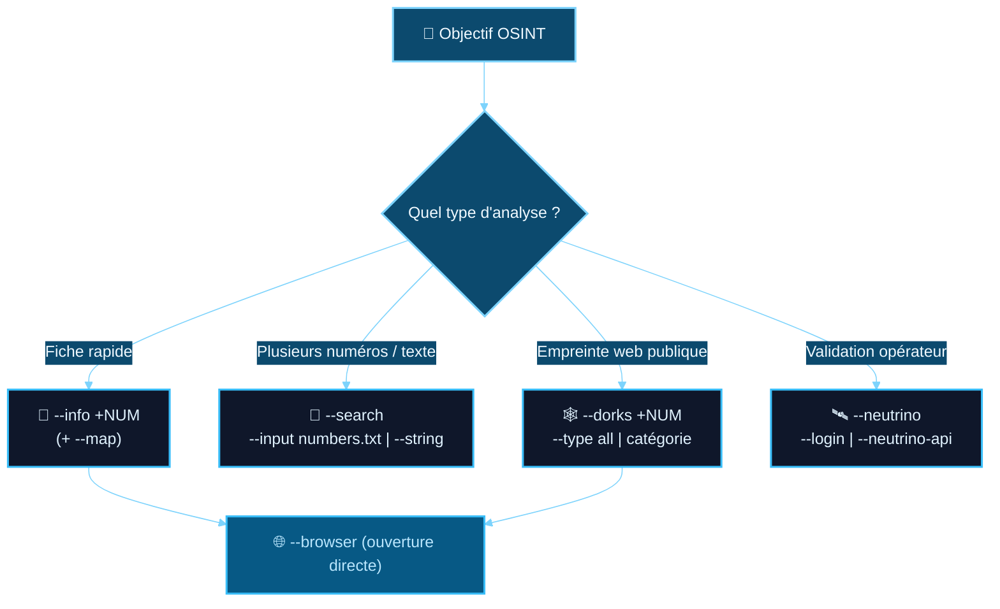

<div align="center">

<!-- BANNIÈRE BLEU CLAIR GUIDE v1.1-alpha -->


<!-- EFFET TERMINAL ANIMÉ -->
<a href="#sommaire">
  
</a>

<br />

<!-- BADGES SHIELDS.IO BLEU CLAIR -->
<p>
  
  
  
  
</p>

</div>

---

<a id="sommaire"></a>

## 🧭 𝗦𝗢𝗠𝗠𝗔𝗜𝗥𝗘 𝗢𝗣𝗘́𝗥𝗔𝗧𝗜𝗢𝗡𝗡𝗘𝗟

| # | Section du Guide | Contenu | Accès |
| :-: | :--- | :--- | :---: |
| `01` | **🫆 Présentation** | Rôle de PhoneIntel & compatibilité Terminal / Termux | [**Aller ➔**](#introduction) |
| `02` | **📥 Installation Rapide** | Déploiement en une commande via `pip` | [**Aller ➔**](#installation) |
| `03` | **🔀 Arbre de Décision** | Quel flag choisir selon votre besoin OSINT (Mermaid) | [**Aller ➔**](#workflow-mermaid) |
| `04` | **🔎 Infos, Recherche & Batch** | `--info`, `--search`, `--string`, `--input` & `--map` | [**Aller ➔**](#commandes-base) |
| `05` | **🕸️ Dorks OSINT (12 Types)** | Catalogue complet `--dorks --type <catégorie>` | [**Aller ➔**](#dorks-osint) |
| `06` | **🌐 Navigateur & API Neutrino** | `--browser`, `--neutrino --login / --show` | [**Aller ➔**](#navigateur-api) |
| `07` | **⚙️ Utilitaires & Console** | `--credits`, `--disclaimer` & bonnes pratiques | [**Aller ➔**](#utilitaires) |

---

<a id="introduction"></a>

## 🫆 𝗣𝗥𝗘́𝗦𝗘𝗡𝗧𝗔𝗧𝗜𝗢𝗡

**PhoneIntel** est un outil **OSINT** (*Open Source Intelligence*) en ligne de commande conçu pour **collecter des informations publiques sur les numéros de téléphone** directement depuis votre terminal (**Linux**, **macOS** ou **🤖 Android 16 / Termux**).

```diff
+ [🫆 INFO]     Obtenir les métadonnées, l'opérateur et la zone géographique d'un numéro
+ [🔍 SEARCH]   Rechercher par numéro, chaîne de texte (--string) ou fichier lot (--input)
+ [🕸️ DORKS]    Générer des dorks OSINT ciblés sur 12 catégories de plateformes publiques
+ [🌐 BROWSER]  Ouvrir directement les résultats et coordonnées dans le navigateur par défaut
+ [🛰️ NEUTRINO] Enrichir et valider les données via l'API Neutrino (optionnel)
```

---

<a id="installation"></a>

## 📥 𝗜𝗡𝗦𝗧𝗔𝗟𝗟𝗔𝗧𝗜𝗢𝗡 𝗥𝗔𝗣𝗜𝗗𝗘

> [!NOTE]
> Assurez-vous que **Python `3.8+`** est installé sur votre système (ou dans **Termux** via `pkg install python`), puis exécutez une seule commande :

```bash
pip install phoneintel
```

Une fois terminé, vérifiez l'installation dans le terminal :

```bash
phoneintel --credits
```

---

<a id="workflow-mermaid"></a>

## 🔀 𝗤𝗨𝗘𝗟𝗟𝗘 𝗖𝗢𝗠𝗠𝗔𝗡𝗗𝗘 𝗖𝗛𝗢𝗜𝗦𝗜𝗥 ? (𝗠𝗲𝗿𝗺𝗮𝗶𝗱)



---

<a id="commandes-base"></a>

## 🔎 𝗖𝗢𝗠𝗠𝗔𝗡𝗗𝗘𝗦 𝗗𝗘 𝗕𝗔𝗦𝗘, 𝗥𝗘𝗖𝗛𝗘𝗥𝗖𝗛𝗘 & 𝗕𝗔𝗧𝗖𝗛

### 1️⃣ Informations sur un numéro (`--info`)

| Description | Commande |
| :--- | :--- |
| Obtenir les informations générales d’un numéro | <kbd>phoneintel --info +14155552671</kbd> |
| Obtenir les coordonnées et afficher l’option carte | <kbd>phoneintel --info +14155552671 --map</kbd> |

```bash
# Informations générales
phoneintel --info +14155552671

# Informations avec option carte géographique
phoneintel --info +14155552671 --map
```

### 2️⃣ Recherche avancée & traitement par lots (`--search`)

| Description | Commande |
| :--- | :--- |
| Rechercher un numéro de téléphone | <kbd>phoneintel --search +14155552671</kbd> |
| Rechercher à l’aide d’une chaîne de texte | <kbd>phoneintel --search --string "John Doe"</kbd> |
| Traiter plusieurs numéros via un fichier d’entrée | <kbd>phoneintel --search --input numbers.txt</kbd> |
| Rechercher avec enrichissement API Neutrino | <kbd>phoneintel --search +14155552671 --neutrino-api</kbd> |
| Rechercher avec affichage de carte | <kbd>phoneintel --search +14155552671 --map</kbd> |

```bash
phoneintel --search +14155552671
phoneintel --search --string "John Doe"
phoneintel --search --input numbers.txt
phoneintel --search +14155552671 --neutrino-api
phoneintel --search +14155552671 --map
```

> [!TIP]
> Pour le mode `--input numbers.txt`, placez **un numéro au format international E.164 par ligne** (ex. `+33612345678`, `+14155552671`).

---

<a id="dorks-osint"></a>

## 🕸️ 𝗚𝗘́𝗡𝗘́𝗥𝗔𝗧𝗜𝗢𝗡 𝗗𝗘 𝗗𝗢𝗥𝗞𝗦 𝗢𝗦𝗜𝗡𝗧 (`--dorks`)

Générez des requêtes de reconnaissance ciblées sur **12 catégories** de plateformes publiques :

| Catégorie (`--type`) | Plateformes ciblées | Commande |
| :--- | :--- | :--- |
| `social_networks` | Réseaux sociaux | `phoneintel --dorks +14155552671 --type social_networks` |
| `forums` | Forums de discussion | `phoneintel --dorks +14155552671 --type forums` |
| `classifieds` | Sites de petites annonces | `phoneintel --dorks +14155552671 --type classifieds` |
| `ecommerce` | Plateformes e-commerce | `phoneintel --dorks +14155552671 --type ecommerce` |
| `news` | Sites d’actualités & presse | `phoneintel --dorks +14155552671 --type news` |
| `blogs` | Blogs & publications | `phoneintel --dorks +14155552671 --type blogs` |
| `job_sites` | Sites d’offres d’emploi & CV | `phoneintel --dorks +14155552671 --type job_sites` |
| `pastes` | Sites de partage de texte (*pastes*) | `phoneintel --dorks +14155552671 --type pastes` |
| `reputation` | Sites de réputation & signalement | `phoneintel --dorks +14155552671 --type reputation` |
| `phone_directories` | Annuaires téléphoniques publics | `phoneintel --dorks +14155552671 --type phone_directories` |
| `people_search` | Moteurs de recherche de personnes | `phoneintel --dorks +14155552671 --type people_search` |
| `all` | **Toutes les catégories disponibles** | `phoneintel --dorks +14155552671 --type all` |

<details>
<summary><b>⚡ Copier-coller rapide des combinaisons --dorks complètes</b></summary>

```bash
# Générer tous les dorks disponibles
phoneintel --dorks +14155552671 --type all

# Générer tous les dorks avec l'option carte
phoneintel --dorks +14155552671 --type all --map

# Générer les dorks en enrichissant avec l'API Neutrino
phoneintel --dorks +14155552671 --type all --neutrino-api
```

</details>

---

<a id="navigateur-api"></a>

## 🌐 𝗡𝗔𝗩𝗜𝗚𝗔𝗧𝗘𝗨𝗥 & 𝗔𝗣𝗜 𝗡𝗘𝗨𝗧𝗥𝗜𝗡𝗢

### 1️⃣ Ouverture directe dans le navigateur (`--browser`)

```bash
# Ouvrir les résultats de recherche dans votre navigateur par défaut
phoneintel --browser +14155552671

# Ouvrir avec les informations enrichies de l'API Neutrino
phoneintel --browser +14155552671 --neutrino-api

# Ouvrir avec l'option carte géographique
phoneintel --browser +14155552671 --map
```

### 2️⃣ Configuration & Requêtes API Neutrino (`--neutrino`)

> [!IMPORTANT]
> Remplacez `YOUR_API_ID` et `YOUR_API_KEY` par vos propres identifiants Neutrino avant d’exécuter les commandes ci-dessous.

```bash
# Enregistrer vos identifiants API Neutrino
phoneintel --neutrino --login --id YOUR_API_ID --key YOUR_API_KEY

# Afficher les identifiants API enregistrés
phoneintel --neutrino --show

# Analyser un numéro via l'API Neutrino
phoneintel --neutrino +14155552671

# Analyser via l'API Neutrino avec l'option carte
phoneintel --neutrino +14155552671 --map
```

---

<a id="utilitaires"></a>

## ⚙️ 𝗨𝗧𝗜𝗟𝗜𝗧𝗔𝗜𝗥𝗘𝗦 & 𝗖𝗔𝗗𝗥𝗘 𝗟𝗘́𝗚𝗔𝗟

```bash
# Afficher les crédits du projet
phoneintel --credits

# Afficher la clause de non-responsabilité
phoneintel --disclaimer
```

> [!WARNING]
> **Rappel :** PhoneIntel est conçu exclusivement pour l’apprentissage de l’OSINT, la recherche légitime sur données publiques et les audits de sécurité autorisés.

---

<div align="center">


**🫆 𝗚𝗨𝗜𝗗𝗘 𝗣𝗛𝗢𝗡𝗘𝗜𝗡𝗧𝗘𝗟 `v1.1-alpha` — *Documentation Terminal & Termux.***
<br />
<sub>⬆️ <a href="#sommaire"><b>Retour au Sommaire</b></a> • <a href="README.md"><b>Voir le README principal</b></a> ⬆️</sub>

</div>
