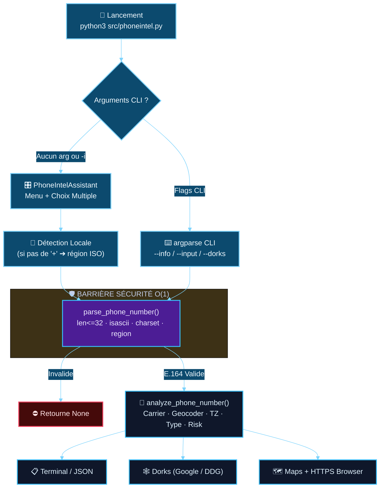

<div align="center">

<!-- BANNIÈRE BLEU CLAIR PHONEINTEL.PY -->


<!-- TERMINAL ANIMÉ -->
<a href="#sommaire">
  
</a>

<br />

<!-- BADGES SHIELDS.IO BLEU CLAIR -->
<p>
  
  
  
  
  
</p>

</div>

---

<a id="sommaire"></a>

## 🧭 𝗦𝗢𝗠𝗠𝗔𝗜𝗥𝗘 𝗢𝗣𝗘́𝗥𝗔𝗧𝗜𝗢𝗡𝗡𝗘𝗟

| # | Section | Contenu détaillé | Accès |
| :-: | :--- | :--- | :---: |
| `01` | **🫆 Présentation du Module** | Rôle de `src/phoneintel.py`, dépendance `phonenumbers` & points forts | [**Voir ➔**](#presentation) |
| `02` | **📥 Installations Guidées** | Guides pas-à-pas : Linux, 🤖 Android 16 (Termux), Windows & `requirements.txt` | [**Voir ➔**](#installations) |
| `03` | **🧠 Architecture & Flux (Mermaid)** | Cheminement CLI vs Assistant, garde-fous O(1) et sorties | [**Voir ➔**](#architecture) |
| `04` | **🎛️ Assistant Interactif Avancé** | Guide complet du mode interactif, options intelligentes & multi-choix | [**Voir ➔**](#assistant) |
| `05` | **⌨️ Référence Complète CLI** | Tous les flags `argparse`, format JSON, batch `.txt` & Dorks | [**Voir ➔**](#cli) |
| `06` | **📚 API Python & Référence Code** | Constantes, dataclasses (`PhoneIntelReport`) et fonctions publiques | [**Voir ➔**](#api-interne) |
| `07` | **🛡️ Sécurité, RGPD & Limites** | Anti-DoS O(1), ASCII strict, anti-symlink, HTTPS-only & ITU | [**Voir ➔**](#securite) |
| `08` | **🧯 Dépannage & Bonnes Pratiques** | Erreurs fréquentes (`PYTHONPATH`, couleurs, Termux, tests `pytest`) | [**Voir ➔**](#depannage) |

---

<a id="presentation"></a>

## 🫆 𝗣𝗥𝗘́𝗦𝗘𝗡𝗧𝗔𝗧𝗜𝗢𝗡 𝗗𝗨 𝗠𝗢𝗗𝗨𝗟𝗘

**`src/phoneintel.py`** (`v1.1.0-alpha`) est le **moteur principal** de PhoneINTEL. Il réunit dans un seul fichier autonome et modulaire :

```diff
+ [MOTEUR]     Validation stricte E.164 via `phonenumbers` + garde-fous de sécurité O(1)
+ [OSINT]      Extraction offline : opérateur (carrier), zone géographique, fuseaux horaires & type de ligne
+ [ASSISTANT]  Interface interactive TUI avec détection locale intelligente & sélecteur à choix multiple
+ [DORKS]      Génération sécurisée d'URLs OSINT encodées (Google / DuckDuckGo) sur 7 catégories
+ [BATCH]      Lecture sécurisée de listes `.txt` (anti-symlink, déduplication, plafond 1 000 lignes)
+ [EXPORT]     Sortie structurée JSON UTF-8 et masquage RGPD (`--mask`)
```

> [!NOTE]
> **Une seule dépendance externe requise :** la bibliothèque standard de Google **`phonenumbers`** (tout le reste — `argparse`, `dataclasses`, `json`, `urllib.parse`, `webbrowser`, `pathlib` — provient de la bibliothèque standard Python `3.8+`).

---

<a id="installations"></a>

## 📥 𝗜𝗡𝗦𝗧𝗔𝗟𝗟𝗔𝗧𝗜𝗢𝗡𝗦 𝗚𝗨𝗜𝗗𝗘́𝗘𝗦 (𝗧𝗼𝘂𝘁𝗲𝘀 𝗣𝗹𝗮𝘁𝗲𝗳𝗼𝗿𝗺𝗲𝘀)

### ⚙️ Fichiers de configuration projet recommandés

Avant d’installer, assurez-vous d’avoir un fichier **`requirements.txt`** minimal à la racine :

```text
phonenumbers>=8.13.0,<9.0.0
```

*(Optionnel pour le développement et les tests :)*
```text
pytest>=7.4.0
pytest-cov>=4.1.0
mypy>=1.8.0
ruff>=0.4.0
```

---

### 🐧 Option 1 — Linux (Debian, Ubuntu, Kali, Mint, Arch)

1. **Vérifier Python (`3.8+` requis)** :
   ```bash
   python3 --version
   ```
2. **Cloner le dépôt et créer un environnement virtuel isolé (recommandé)** :
   ```bash
   git clone https://github.com/teremuhamblin/PhoneINTEL.git
   cd PhoneINTEL

   python3 -m venv .venv
   source .venv/bin/activate
   ```
3. **Installer les dépendances** :
   ```bash
   python3 -m pip install --upgrade pip
   pip install phonenumbers
   ```
4. **Tester immédiatement le script** :
   ```bash
   # Lance l'assistant interactif complet
   python3 src/phoneintel.py

   # Ou en mode CLI rapide
   python3 src/phoneintel.py --info +33612345678
   ```
5. *(Optionnel)* **Créer un alias global `phoneintel` dans `~/.bashrc` ou `~/.zshrc`** :
   ```bash
   echo "alias phoneintel='$(pwd)/.venv/bin/python $(pwd)/src/phoneintel.py'" >> ~/.bashrc
   source ~/.bashrc
   ```

---

### 🤖 Option 2 — Android 16 / Termux (`🫆` Mobile OSINT)

1. **Mettre à jour Termux et installer Python + Git** :
   ```bash
   pkg update && pkg upgrade -y
   pkg install -y python git
   ```
2. **Cloner le projet et installer `phonenumbers`** :
   ```bash
   git clone https://github.com/teremuhamblin/PhoneINTEL.git
   cd PhoneINTEL

   python -m venv .venv
   source .venv/bin/activate
   pip install --upgrade pip phonenumbers
   ```
3. **Lancer PhoneINTEL dans Termux** :
   ```bash
   python src/phoneintel.py
   ```

> [!TIP]
> **Astuce Android / Termux :** Si `--browser` ne parvient pas à ouvrir Chrome/Firefox automatiquement depuis Termux, copiez simplement le lien `https://...` généré par `--map` ou `--dorks`, ou installez le paquet `termux-api` (`pkg install termux-api`) avec `BROWSER=termux-open-url`.

---

### 🪟 Option 3 — Windows 10 / 11 (PowerShell)

1. **Vérifier Python et créer l’environnement virtuel** :
   ```powershell
   py --version
   git clone https://github.com/teremuhamblin/PhoneINTEL.git
   cd PhoneINTEL

   py -m venv .venv
   .\.venv\Scripts\Activate.ps1
   ```
2. **Installer `phonenumbers` et lancer** :
   ```powershell
   python -m pip install --upgrade pip phonenumbers
   python src\phoneintel.py
   ```

> [!IMPORTANT]
> Si PowerShell bloque `Activate.ps1`, exécutez une fois : `Set-ExecutionPolicy -ExecutionPolicy RemoteSigned -Scope CurrentUser`.

---

<a id="architecture"></a>

## 🧠 𝗔𝗥𝗖𝗛𝗜𝗧𝗘𝗖𝗧𝗨𝗥𝗘 & 𝗙𝗟𝗨𝗫 𝗗'𝗘𝗫𝗘́𝗖𝗨𝗧𝗜𝗢𝗡 (`Mermaid`)



---

<a id="assistant"></a>

## 🎛️ 𝗚𝗨𝗜𝗗𝗘 𝗗𝗘 𝗟’𝗔𝗦𝗦𝗜𝗦𝗧𝗔𝗡𝗧 𝗜𝗡𝗧𝗘𝗥𝗔𝗖𝗧𝗜𝗙 & 𝗖𝗛𝗢𝗜𝗫 𝗠𝗨𝗟𝗧𝗜𝗣𝗟𝗘

Lorsque vous lancez le script **sans argument** (ou avec `-i` / `--interactive`), l’assistant `PhoneIntelAssistant` démarre automatiquement.

### 1️⃣ Menu Principal

```text
╭──────────────────────────────────────────────────────────────╮
│  🫆  PHONEINTEL v1.1.0-alpha  •  ASSISTANT OSINT INTELLIGENT │
╰──────────────────────────────────────────────────────────────╯
  Région par défaut : FR │ Masquage RGPD : OFF │ Moteur : google

  [1] 🔎 Analyse OSINT intelligente (avec choix multiple)
  [2] 📂 Traitement par lots sécurisé (.txt)
  [3] ⚙️  Options intelligentes & préférences
  [4] ⚖️  Crédits & avertissement légal
  [0] 🚪 Quitter
```

### 2️⃣ Options Intelligentes Intégrées
- **Détection automatique de format local (`_smart_read_number`) :** si vous saisissez `0612345678` (sans `+`), l’assistant repère l’absence d’indicatif international et vous propose immédiatement votre région par défaut (`FR`, modifiable en un appui sur `Entrée`).
- **Couleurs adaptatives (`Palette`) :** les codes couleur ANSI cyan/bleu glacier s’activent uniquement si la sortie est un vrai terminal interactif (`sys.stdout.isatty()`), évitant toute pollution lors des redirections vers un fichier.
- **Configuration dynamique de session (`[3]`) :** changez à la volée la région ISO par défaut (`FR`, `BE`, `CH`, `CA`, `US`, ou `none`), activez le **masquage RGPD** sur toutes les sorties, basculez entre **Google** et **DuckDuckGo**, ou coupez les couleurs.

### 3️⃣ Utilisation du Sélecteur à Choix Multiple (`prompt_multi_choice`)

Chaque étape d’action (modules d’analyse, catégories de Dorks, options batch, paramètres) accepte une saisie souple :

| Saisie | Effet | Exemple concret |
| :--- | :--- | :--- |
| **Liste séparée par virgules** | Sélectionne les éléments exacts | `1,3,5` |
| **Plage continue** | Sélectionne tout l’intervalle inclus | `1-4` |
| **Combinaison mixte** | Fusionne et déduplique en gardant l’ordre | `1-3,5` |
| **`all`** | Sélectionne toutes les options disponibles | `all` |
| **`none`** | Aucune option sélectionnée | `none` |
| **`Entrée` (vide)** | Applique le choix par défaut marqué `*` | `⏎` |

---

<a id="cli"></a>

## ⌨️ 𝗥𝗘́𝗙𝗘́𝗥𝗘𝗡𝗖𝗘 𝗖𝗢𝗠𝗣𝗟𝗘̀𝗧𝗘 𝗖𝗟𝗜 (`argparse`)

### 📋 Tableau complet des arguments

| Argument | Valeur | Description |
| :--- | :--- | :--- |
| `target` *(positionnel)* | `NUM` | Numéro cible direct (ex: `+33612345678`). Rétrocompatible v1.0 |
| `-i`, `--interactive` | — | Force le lancement de l’assistant interactif complet |
| `--info` | `NUM` | Affiche la fiche OSINT complète (opérateur, zone, type, fuseau, risque) |
| `--region` | `ISO` | Code pays à 2 lettres (ex: `FR`, `BE`, `US`) pour parser un numéro local |
| `--input` | `FILE` | Analyse par lots un fichier `.txt` (1 numéro par ligne, `#` ignorés) |
| `--dorks` | `NUM` | Génère des liens de Dorks OSINT pour le numéro donné |
| `--type` | `CATS` | Catégories séparées par virgule ou `all` *(défaut : `all`)* |
| `--engine` | `google` \| `duckduckgo` | Moteur utilisé pour générer les requêtes Dorks *(défaut : `google`)* |
| `--map` | — | Génère un lien cartographique Google Maps HTTPS sûr |
| `--browser` | — | Ouvre le lien carte dans le navigateur (schéma `https://` vérifié) |
| `--mask` | — | Active le masquage RGPD (`+33******78`) dans l’affichage et le JSON |
| `--json` | — | Sortie structurée au format JSON UTF-8 |
| `--no-color` | — | Désactive la coloration ANSI dans le terminal |

### 🧪 Exemples concrets prêts à exécuter

```bash
# 1. Validation simple (rétrocompatible v1.0)
python3 src/phoneintel.py +33612345678

# 2. Analyse d'un numéro local français avec fiche complète
python3 src/phoneintel.py --info "06 12 34 56 78" --region FR

# 3. Sortie JSON masquée RGPD (idéal pour pipeline / logging)
python3 src/phoneintel.py --info +33612345678 --mask --json

# 4. Dorks ciblés sur DuckDuckGo (réseaux sociaux + réputation)
python3 src/phoneintel.py --dorks +33612345678 --type social_networks,reputation --engine duckduckgo

# 5. Traitement par lots d'un fichier numbers.txt avec export JSON redirigé
python3 src/phoneintel.py --input numbers.txt --region FR --mask --json > rapport_batch.json
```

<details>
<summary><b>📄 Exemple de sortie JSON générée par <code>--info +33612345678 --json</code> (cliquer pour déplier)</b></summary>

```json
{
  "input_masked": "+33******78",
  "e164": "+33612345678",
  "international": "+33 6 12 34 56 78",
  "national": "06 12 34 56 78",
  "rfc3966": "tel:+33-6-12-34-56-78",
  "country_code": 33,
  "region_code": "FR",
  "line_type": "Mobile",
  "carrier_name": "Orange",
  "location": "France",
  "timezones": [
    "Europe/Paris"
  ],
  "risk_hint": "Standard (Numéro attribué valide)"
}
```

</details>

---

<a id="api-interne"></a>

## 📚 𝗔𝗣𝗜 𝗣𝗬𝗧𝗛𝗢𝗡 & 𝗥𝗘́𝗙𝗘́𝗥𝗘𝗡𝗖𝗘 𝗗𝗨 𝗖𝗢𝗗𝗘

Vous pouvez importer `src/phoneintel.py` directement dans vos propres scripts Python :

```python
from src.phoneintel import analyze_phone_number, generate_dorks, parse_phone_number

e164 = parse_phone_number("06 12 34 56 78", region="FR")
report = analyze_phone_number("06 12 34 56 78", region="FR", mask_output=False)
if report:
    print(report.carrier_name, report.location, report.timezones)
```

### 1️⃣ Constantes de contrôle

| Constante | Valeur | Rôle |
| :--- | :--- | :--- |
| `VERSION` | `"1.1.0-alpha"` | Version affichée dans la bannière et les crédits |
| `MAX_INPUT_LENGTH` | `32` | Longueur max acceptée avant parsing (**garde-fou O(1)**) |
| `MAX_BATCH_FILE_BYTES` | `1_048_576` (`1 Mo`) | Taille maximale autorisée pour un fichier `--input` |
| `MAX_BATCH_LINES` | `1_000` | Plafond de lignes lues en une opération batch |
| `ALLOWED_PHONE_CHARS` | `"0123456789+ -()."` | Caractères strictement autorisés après contrôle ASCII |
| `DORK_CATEGORIES` | `7` catégories | `social_networks`, `forums`, `pastes`, `ecommerce`, `news`, `phone_directories`, `reputation` |

### 2️⃣ Modèles de données (`dataclasses`)

- **`PhoneIntelReport` (`frozen=True`, immuable)** :
  `input_masked`, `e164`, `international`, `national`, `rfc3966`, `country_code`, `region_code`, `line_type`, `carrier_name`, `location`, `timezones`, `risk_hint`.
- **`AssistantConfig`** :
  `default_region` (`"FR"`), `rgpd_mask_output` (`False`), `search_engine` (`"google"`), `use_color` (`True`).

### 3️⃣ Fonctions exposées

| Fonction | Signature & Rôle |
| :--- | :--- |
| `parse_phone_number` | `(number: str, region: Optional[str] = None) -> Optional[str]` — Valide et formate en E.164 |
| `analyze_phone_number` | `(number: str, region: Optional[str] = None, mask_output: bool = False) -> Optional[PhoneIntelReport]` |
| `mask_phone_number` | `(e164: str) -> str` — Masque le cœur du numéro (`+33******78`) |
| `generate_dorks` | `(e164: str, categories: Sequence[str], engine: str = "google") -> Dict[str, str]` |
| `build_map_url` | `(location_query: str) -> str` — Génère une URL Google Maps encodée |
| `open_safe_url` | `(url: str) -> bool` — Ouvre dans le navigateur uniquement si `scheme == "https"` |
| `read_batch_file` | `(file_path: str) -> List[str]` — Lit, valide, nettoie et déduplique un fichier `.txt` |
| `export_reports_json` | `(reports: Sequence[PhoneIntelReport], output_path: str) -> Path` — Écrit un JSON UTF-8 sûr |

---

<a id="securite"></a>

## 🛡️ 𝗦𝗘́𝗖𝗨𝗥𝗜𝗧𝗘́, 𝗥𝗚𝗣𝗗 & 𝗟𝗜𝗠𝗜𝗧𝗘𝗦 𝗧𝗘𝗖𝗛𝗡𝗜𝗤𝗨𝗘𝗦

> [!CAUTION]
> **Cadre d’utilisation :** PhoneINTEL exploite uniquement des métadonnées publiques et des bibliothèques de numérotation standards. Respectez toujours les lois locales sur la vie privée et ne stockez pas de numéros personnels en clair dans des logs non chiffrés (utilisez `--mask`).

| Protection implémentée | Mécanisme dans `src/phoneintel.py` | Menace neutralisée |
| :--- | :--- | :--- |
| **Garde-fou longueur O(1)** | Rejet immédiat si `len(number) > 32` ou non-`str` | Déni de service CPU / mémoire sur entrée géante |
| **ASCII strict** | `number.isascii()` + liste blanche `ALLOWED_PHONE_CHARS` | Contournements Unicode (`٣`), homoglyphes (`＋`), `\n`, `\x00` |
| **Position du `+`** | Interdit plusieurs `+` ou un `+` ailleurs qu’en tête | Bypasses de parsing type `33+612345678` |
| **Region ISO validée** | `_sanitize_region()` : 2 lettres alpha ASCII | Injection ou plantage sur région malformée |
| **Batch & Export sûrs** | Rejet des `symlink`, taille max 1 Mo, encodage UTF-8 strict | Lecture/écriture arbitraire par lien symbolique |
| **URL & Navigateur** | `urllib.parse.quote_plus()` + vérification `https` + `netloc` | Injection de paramètres URL ou schémas `file://` / `javascript:` |

> [!WARNING]
> **Comportement de `phonenumbers.is_valid_number()` sur les numéros fictifs :**
> `phonenumbers` applique les **plans de numérotation réels de l’ITU** (et non une simple règle de longueur 7–15 chiffres). Ainsi, `+33612345678` est accepté, tandis qu’un numéro purement artificiel comme `+1234567` ou `+14155552671` peut être refusé par `libphonenumber` s’il ne correspond pas à une plage attribuée. Pensez-y lors de l’écriture de vos jeux de tests dans `tests/test_phoneintel.py`.

---

<a id="depannage"></a>

## 🧯 𝗗𝗘́𝗣𝗔𝗡𝗡𝗔𝗚𝗘 𝗥𝗔𝗣𝗜𝗗𝗘

| Symptôme | Cause probable | Solution |
| :--- | :--- | :--- |
| `ModuleNotFoundError: No module named 'phonenumbers'` | Environnement virtuel non activé ou dépendance absente | `source .venv/bin/activate && pip install phonenumbers` |
| `ModuleNotFoundError: No module named 'src'` *(avec `pytest`)* | Racine du projet absente du `PYTHONPATH` | Lancer `python3 -m pytest -v` depuis la racine du dépôt |
| Caractères étranges `\033[96m` dans PowerShell / fichier | Terminal sans support ANSI ou redirection non-TTY | Ajouter `--no-color` |
| `SyntaxError` sur `:=` ou `from __future__` | Version de Python trop ancienne (`< 3.8`) | Installer Python `3.8+` (`python3 --version`) |
| `Erreur batch : Fichier invalide ou non autorisé` | Le fichier est un lien symbolique, inexistant ou `> 1 Mo` | Copier un vrai fichier `.txt` de moins de 1 000 lignes |

---

<div align="center">


**🫆 𝗽𝗵𝗼𝗻𝗲𝗶𝗻𝘁𝗲𝗹.𝗽𝘆 `v1.1.0-alpha` — *Documentation Complète, Sécurité O(1) & Assistant OSINT.***
<br />
<sub>⬆️ <a href="#sommaire"><b>Retour au Sommaire</b></a> • <a href="README.md"><b>README</b></a> • <a href="GUIDES.md"><b>Guide CLI</b></a> • <a href="test.md"><b>Suite de Tests</b></a> ⬆️</sub>

</div>
