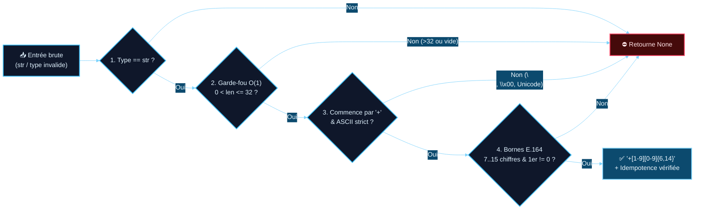

<div align="center">

<!-- BANNIÈRE BLEU CLAIR TEST SUITE v1.1-alpha -->


<!-- EFFET TERMINAL ANIMÉ -->
<a href="#sommaire">
  
</a>

<br />

<!-- BADGES SHIELDS.IO BLEU CLAIR -->
<p>
  
  
  
  
</p>

</div>

---

<a id="sommaire"></a>

## 🧭 𝗦𝗢𝗠𝗠𝗔𝗜𝗥𝗘 𝗢𝗣𝗘́𝗥𝗔𝗧𝗜𝗢𝗡𝗡𝗘𝗟

| # | Section | Ce que vous allez trouver | Accès |
| :-: | :--- | :--- | :---: |
| `01` | **🫆 Vue d’ensemble** | Rôle du module de test & fichiers concernés | [**Voir ➔**](#vue-ensemble) |
| `02` | **🚀 Améliorations Avancées** | Évolution v1.0 ➔ v1.1-alpha (sécurité, performance, typage) | [**Voir ➔**](#ameliorations) |
| `03` | **🔄 Pipeline de Validation** | Diagramme Mermaid du flux `parse_phone_number` & assertions | [**Voir ➔**](#mermaid-pipeline) |
| `04` | **🧪 Catalogue des 28 Tests** | Détail complet des 4 fonctions `pytest` & jeux d'essai | [**Voir ➔**](#catalogue-tests) |
| `05` | **🛡️ Pièges Python Neutralisés** | Unicode `\d`, regex `$` + `\n`, DoS `100k`, RGPD | [**Voir ➔**](#securite-python) |
| `06` | **⚙️ Exécution, Couverture & CI** | Commandes `pytest`, `mypy`, `ruff` & workflow GitHub Actions | [**Voir ➔**](#execution-ci) |
| `07` | **🧯 Dépannage Rapide** | Résolution de `ModuleNotFoundError: No module named 'src'` | [**Voir ➔**](#depannage) |

---

<a id="vue-ensemble"></a>

## 🫆 𝗩𝗨𝗘 𝗗’𝗘𝗡𝗦𝗘𝗠𝗕𝗟𝗘

La suite de tests **`tests/test_phoneintel.py`** valide la robustesse, la conformité **E.164** et la résistance aux entrées hostiles de la fonction **`parse_phone_number(raw_number: str) -> str | None`** située dans **`src/phoneintel.py`**.

```text
PhoneINTEL/
├── src/
│   └── phoneintel.py          ──► Implémentation durcie (sans regex, garde-fou O(1), ASCII strict)
├── tests/
│   └── test_phoneintel.py     ──► 4 fonctions de tests / 28 cas exécutés via @pytest.mark.parametrize
├── pyproject.toml             ──► Configuration optionnelle pytest / mypy / ruff
└── test.md                    ──► Ce manuel technique de test
```

---

<a id="ameliorations"></a>

## 🚀 𝗔𝗠𝗘́𝗟𝗜𝗢𝗥𝗔𝗧𝗜𝗢𝗡𝗦 𝗔𝗩𝗔𝗡𝗖𝗘́𝗘𝗦 (`v1.0` ➔ `v1.1-alpha`)

```diff
- [v1.0]  2 tests isolés (+33612345678 et "12345"), aucune assertion de temps ni de sécurité
+ [v1.1]  28 cas paramétrés avec identifiants explicites (ids=[...]) pour un diagnostic immédiat
+ [PERF]  Test anti-DoS / anti-ReDoS : charge de 100 000 caractères rejetée en < 50 ms (O(1))
+ [SEC]   Tests de contournement : octet nul (\x00), saut de ligne (\n), shell, XSS, Unicode, homoglyphes
+ [TYPE]  Tests de robustesse sur types non-chaînes (None, int, list, dict) + compatibilité Python 3.8+
+ [CONTR] Vérification d'idempotence : parse(parse(x)) == parse(x) et ASCII strict garanti
+ [RGPD]  Utilisation exclusive de plages de test officielles réservées (ARCEP, NANP 555, Ofcom)
```

---

<a id="mermaid-pipeline"></a>

## 🔄 𝗣𝗜𝗣𝗘𝗟𝗜𝗡𝗘 𝗗𝗘 𝗩𝗔𝗟𝗜𝗗𝗔𝗧𝗜𝗢𝗡 (𝗠𝗲𝗿𝗺𝗮𝗶𝗱)



---

<a id="catalogue-tests"></a>

## 🧪 𝗖𝗔𝗧𝗔𝗟𝗢𝗚𝗨𝗘 𝗗𝗘𝗦 𝟮𝟴 𝗧𝗘𝗦𝗧𝗦 (`tests/test_phoneintel.py`)

### 1️⃣ `test_parse_valid_phone_numbers` — **8 cas valides & contrat de sortie**

Vérifie que chaque numéro valide est normalisé au format **E.164 strict**, respecte le type `str`, ne contient que de l’ASCII et reste **idempotent** (`parse(parse(x)) == parse(x)`).

| ID du test | Entrée testée | Sortie attendue | Rôle |
| :--- | :--- | :--- | :--- |
| `fr_e164` | `"+33612345678"` | `"+33612345678"` | Plage fictive française ARCEP |
| `us_e164` | `"+14155552671"` | `"+14155552671"` | Plage fictive US NANP |
| `uk_e164` | `"+447700900077"` | `"+447700900077"` | Plage fictive UK Ofcom |
| `e164_min_7_digits` | `"+1234567"` | `"+1234567"` | Borne basse E.164 (`7` chiffres) |
| `e164_max_15_digits` | `"+123456789012345"` | `"+123456789012345"` | Borne haute E.164 (`15` chiffres) |
| `spaces_trimmed` | `"  +33 6 12 34 56 78  "` | `"+33612345678"` | Nettoyage des espaces |
| `dashes_normalized` | `"+33-6-12-34-56-78"` | `"+33612345678"` | Suppression des tirets |
| `parentheses_normalized` | `"+1 (415) 555-2671"` | `"+14155552671"` | Suppression des parenthèses |

---

### 2️⃣ `test_parse_invalid_and_malicious_inputs` — **15 cas invalides & hostiles**

Garantit que toutes les entrées malformées ou offensives retournent strictement **`None`** sans lever d'exception :

| Catégorie | Cas testés (`ids`) | Pourquoi c'est critique |
| :--- | :--- | :--- |
| **Vide / Court** | `empty`, `whitespace_only`, `too_short_no_plus`, `below_e164_min` | Empêche les faux positifs sous 7 chiffres ou sans `+` |
| **Hors standard E.164** | `above_e164_max` (16 chiffres), `leading_zero_country_code` (`+0...`), `double_plus`, `misplaced_plus` | Respect strict de la norme ITU-T E.164 |
| **Injections & Bypass** | `trailing_newline_bypass` (`\n`), `null_byte` (`\x00`), `shell_injection`, `xss_payload`, `alpha_char` | Bloque les contournements CRLF, null-byte et payloads |
| **Unicode / Homoglyphes** | `unicode_arabic_digits` (`+٣٣٦...`), `fullwidth_homoglyphs` (`＋３３...`) | Bloque les chiffres non-ASCII acceptés par `str.isdigit()` |

---

### 3️⃣ `test_parse_non_string_input_is_safe` — **4 cas de types inattendus**

Teste `None`, `33612345678` (`int`), `["+33612345678"]` (`list`) et `{"num": "+33612345678"}` (`dict`).
- L’annotation `# type: ignore[arg-type]` indique volontairement à `mypy` que ces appels simulent une mauvaise utilisation dynamique à l'exécution.

---

### 4️⃣ `test_parse_oversized_input_rejected_in_o1_time` — **1 test anti-DoS / anti-ReDoS**

Envoie une chaîne malveillante de **100 001 caractères** (`"+" + "1" * 100_000`) et mesure le temps d’exécution via `time.perf_counter()` :
- Le résultat doit être `None`.
- Le temps écoulé doit être strictement inférieur à **`0.05 s`** (`MAX_PROCESSING_SECONDS`).

---

<a id="securite-python"></a>

## 🛡️ 𝗣𝗜𝗘̀𝗚𝗘𝗦 𝗗𝗘 𝗦𝗘́𝗖𝗨𝗥𝗜𝗧𝗘́ 𝗣𝗬𝗧𝗛𝗢𝗡 𝗡𝗘𝗨𝗧𝗥𝗔𝗟𝗜𝗦𝗘́𝗦

> [!WARNING]
> **Pourquoi `src/phoneintel.py` n’utilise PAS d’expression régulière classique ?**
> Trois vulnérabilités classiques existent en Python 3 lors de la validation d’un numéro par `re` ou `isdigit()` :

1. **Piège n°1 — `\d` et `.isdigit()` matchent l’Unicode :**
   ```python
   "+٣٣٦١٢٣٤٥٦٧٨"[1:].isdigit()  # ➜ True en Python 3 !
   ```
   **Notre parade :** comparaison stricte de plage ASCII **`"0" <= ch <= "9"`** (et vérification `.isascii()` dans les tests).

2. **Piège n°2 — `$` en regex accepte un `\n` final :**
   ```python
   bool(re.match(r"^\+\d{7,15}$", "+33612345678\n"))  # ➜ True ! (contournement CRLF)
   ```
   **Notre parade :** parcours explicite caractère par caractère rejetant immédiatement `\n`, `\r` et `\x00`.

3. **Piège n°3 — Déni de service (DoS / ReDoS) sur entrée géante :**
   **Notre parade :** test immédiat en tête de fonction **`len(raw_number) > 32`** avant toute allocation mémoire ou boucle (`O(1)` garanti).

<details>
<summary><b>📄 Voir les constantes internes et le code complet de référence (cliquer pour déplier)</b></summary>

- `_MAX_RAW_LENGTH = 32` : borne maximale acceptée en entrée brute.
- `_MIN_E164_DIGITS = 7` / `_MAX_E164_DIGITS = 15` : plage ITU-T E.164.
- `_ALLOWED_SEPARATORS = {" ", "-", ".", "(", ")"}` : séparateurs nettoyés lors de la normalisation.
- **Compatibilité Python 3.8+** : assurée par `from __future__ import annotations` qui active le typage `str | None` même sous Python 3.8 / 3.9.

</details>

---

<a id="execution-ci"></a>

## ⚙️ 𝗘𝗫𝗘́𝗖𝗨𝗧𝗜𝗢𝗡, 𝗖𝗢𝗨𝗩𝗘𝗥𝗧𝗨𝗥𝗘 & 𝗖𝗜

### 1️⃣ Préparer l’environnement de test

```bash
python3 -m venv .venv
source .venv/bin/activate
pip install pytest pytest-cov mypy ruff bandit
```

### 2️⃣ Commandes utiles au quotidien

```bash
# Lancer toute la suite avec le détail des 28 cas
python3 -m pytest -v tests/test_phoneintel.py

# Cibler uniquement les tests de sécurité Unicode / injection / DoS
python3 -m pytest -v -k "unicode or injection or oversized"

# Mesurer la couverture de code de src/phoneintel.py
python3 -m pytest --cov=src --cov-report=term-missing

# Vérifier le typage statique & la sécurité statique
mypy src tests
ruff check src tests
bandit -r src
```

### 3️⃣ Automatisation GitHub Actions (`.github/workflows/tests.yml`)

```yaml
name: 🫆 PhoneINTEL Tests & Security

on:
  push:
    branches: [ main ]
  pull_request:
    branches: [ main ]

jobs:
  pytest:
    runs-on: ubuntu-latest
    strategy:
      matrix:
        python-version: [ "3.8", "3.10", "3.12" ]

    steps:
      - uses: actions/checkout@v4

      - name: Set up Python ${{ matrix.python-version }}
        uses: actions/setup-python@v5
        with:
          python-version: ${{ matrix.python-version }}

      - name: Install test dependencies
        run: python -m pip install --upgrade pip pytest pytest-cov

      - name: Run unit & security tests
        run: python -m pytest -v --cov=src --cov-report=term-missing
```

---

<a id="depannage"></a>

## 🧯 𝗗𝗘́𝗣𝗔𝗡𝗡𝗔𝗚𝗘 𝗥𝗔𝗣𝗜𝗗𝗘

> [!TIP]
> **Erreur fréquente : `ModuleNotFoundError: No module named 'src'`**
>
> Si vous lancez `pytest` directement, Python n’ajoute pas toujours la racine du projet au `PYTHONPATH`. Deux solutions propres :
> 1. Utiliser **`python3 -m pytest -v`** depuis la racine du dépôt.
> 2. Ou ajouter ce bloc dans **`pyproject.toml`** à la racine :
>    ```toml
>    [tool.pytest.ini_options]
>    pythonpath = ["."]
>    testpaths = ["tests"]
>    ```

---

<div align="center">


**🫆 𝗧𝗘𝗦𝗧𝗦 𝗣𝗛𝗢𝗡𝗘𝗜𝗡𝗧𝗘𝗟 `v1.1-alpha` — *28 assertions rapides, déterministes et durcies.***
<br />
<sub>⬆️ <a href="#sommaire"><b>Retour au Sommaire</b></a> • <a href="README.md"><b>README</b></a> • <a href="GUIDES.md"><b>Guide CLI</b></a> ⬆️</sub>

</div>
